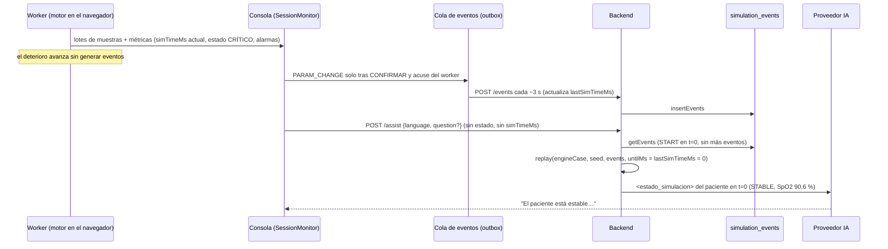
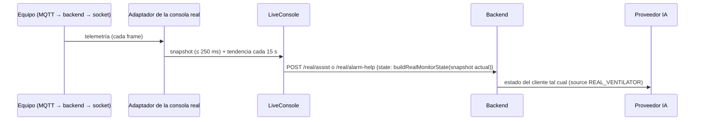

<!--
  Funcionalidad: Diagnóstico del error de contexto de la asistencia de IA del simulador
  Descripción: Fase 1 (diagnóstico) y fase 2 (corrección, §8) del error por el que "Asesoría IA" (SIM_ASSIST) y "¿Cómo estabilizar?" (SIM_ALARM_HELP) razonan sobre el estado inicial del caso y no sobre el estado actual del paciente: causa raíz con referencias a archivo y línea, flujo completo en modo digital y real, contexto real capturado frente a lo que muestra la pantalla, cola de eventos pendientes, inventario de campos de ambos prompts y viabilidad de la corrección (fase 2)
  Versión: 1.1 (§8 Corrección)
  Autor: Marcela Mazo Castro
  Proyecto: VentyLab
  Tesis: Desarrollo de una aplicación web para la enseñanza de mecánica ventilatoria que integre un sistema de retroalimentación usando modelos de lenguaje
  Institución: Universidad del Valle
  Contacto: marcela.mazo@correounivalle.edu.co
-->

# Diagnóstico: la asistencia de IA del simulador ve el paciente inicial

**Estado:** fase 1 cerrada (diagnóstico con evidencia, §1 a §7); fase 2 implementada en las ramas `fix/sim-assist-current-state` de ambos repos (§8), pendiente de revisión y fusión.

**Síntoma (capturas):** la pantalla muestra "Crítico · gravedad 48 %", alarmas "PAM baja: 63,2 (límite 65)" y "SpO₂ baja: 70,8 (límite 90)", pero la Asesoría IA responde "El paciente está estable", "SpO₂ en 89 %", "pH y PaCO₂ dentro de rangos normales". En "¿Cómo estabilizar?" con SpO₂ 78 % en pantalla, la IA habla de SpO₂ 89 %.

**Conclusión:** confirmado. En modo digital la IA recibe el estado del paciente en el tiempo simulado del **último evento persistido**. Si el estudiante no cambia ningún parámetro, ese tiempo es 0 y la IA ve el paciente inicial del caso. La hipótesis B queda confirmada. El modo real no tiene este error.

Referencias de servidor relativas a `ventylab-server/` y de web a `ventilab-web/`.

---

## 1. Causa raíz

### 1.1 Causa principal: el servidor repite la simulación solo hasta `lastSimTimeMs`

1. El cliente no envía estado ni tiempo simulado. El cuerpo de la Asesoría IA es solo `{ language, question? }` (`src/features/simulator/api/services/simulation-assist.service.ts:27-38`). El de "¿Cómo estabilizar?" es `{ alarmCode, language }` (`src/features/simulator/api/services/simulation-alarm-help.service.ts:32-35`). Los DTO del servidor tampoco tienen ese campo (`src/features/simulation/presentation/dtos/simulation-assist-request.dto.ts:19-34`; `SimulationAlarmHelpDTO` en `src/features/simulation/presentation/dtos/monitor-help-request.dto.ts:50-55`).
2. El servidor reconstruye el estado repitiendo los eventos persistidos, pero solo hasta `session.lastSimTimeMs`:
   `const result = this._runtime.replay(context, session.lastSimTimeMs);` (`src/features/simulation/application/services/simulation-assist-context.service.ts:60`). Las métricas, alarmas, objetivos y tendencias del contexto salen de ese resultado (`:72-77`).
3. `lastSimTimeMs` solo avanza cuando llega un lote de eventos: `session.recordActivity(lastSimTimeMs, now)` con el `simTimeMs` del último evento (`src/features/simulation/application/use-cases/append-simulation-events.usecase.ts:154-158`; entidad en `src/features/simulation/domain/entities/simulation-session.entity.ts:171-172`). Al crear la sesión vale 0 (`simulation-session.entity.ts:158`).
4. Los únicos eventos que el cliente puede enviar son `PARAM_CHANGE` y `ALARM_ACK` (`src/features/simulation/domain/value-objects/simulation-session-values.ts:42`). La web nunca emite `ALARM_ACK` (solo aparece en el contrato generado y en textos). **El deterioro por inacción no genera ningún evento.** Por eso, sin cambios de parámetros, `lastSimTimeMs = 0` y la repetición se queda en t = 0.
5. Además, `recordAiHelp` registra el evento `AI_HELP` en `session.lastSimTimeMs` y llama a `recordActivity(session.lastSimTimeMs, …)` (`simulation-assist-context.service.ts:113-117`). Pedir ayuda no adelanta el reloj.

**Hipótesis B: confirmada.** Si hubo un `PARAM_CHANGE`, la IA ve el paciente en el instante de ese último cambio, no en el actual. El desfase crece con cada segundo sin cambios.

### 1.2 Efectos derivados de la misma causa

- **"¿Cómo estabilizar?"** usa el mismo contexto (`src/features/simulation/application/monitor-help/alarm-help-simulation.usecase.ts:70`). Las reglas deterministas (`ruleContextOf`, `:40`, usado en `:78`) y el respaldo sin IA (`:87`) también calculan con la SpO₂, la PAM, la meseta y la auto-PEEP iniciales. En la captura, la IA recibe la alarma `LOW_SPO2` junto con un estado que dice `"alarms":[]` y el objetivo de SpO₂ `MET`: una contradicción interna.
- **Respaldo determinista de la Asesoría IA:** `adviseDeterministically(input, …)` recibe el mismo `input` desactualizado (`src/features/simulation/application/assist/assist-simulation.usecase.ts:65`).
- **Tendencias vacías:** `buildAssistTrends(result.metricsTimeline, …)` (`simulation-assist-context.service.ts:77`) recibe una línea de tiempo vacía cuando se repite hasta 0. Con t = 0 tampoco hay `lastCycle`, ni ventilación, ni presiones (ver la captura).
- **Mismo patrón en otras rutas, fuera del alcance de este error:** `GET /sessions/:id/state` (`src/features/simulation/application/use-cases/get-simulation-session-state.usecase.ts:41`) y el resumen o nota de una sesión activa (`src/features/simulation/application/services/simulation.facade.ts:115`, `src/features/simulation/application/use-cases/get-simulation-session-summary.usecase.ts:43`) también repiten hasta `lastSimTimeMs`. El cierre normal (`POST /end`) no tiene el problema: el cliente envía su tiempo, o el servidor lo estima con el reloj (`src/features/simulation/application/use-cases/end-simulation-session.usecase.ts:64-67` y `:81-87`).
- **Riesgo relacionado, no observado en las capturas:** como `lastEventAt` solo se actualiza con eventos o con ayudas de IA, una sesión en la que no se toca nada pasa a `ABANDONED` tras `SIMULATION_ABANDON_AFTER_MINUTES` (30 min por defecto) aunque el navegador siga simulando (`src/features/simulation/application/services/simulation-session-runtime.service.ts:257`). Desde ese momento la ayuda responde 409.

### 1.3 Causa secundaria latente: recorte del estado en SIM_ALARM_HELP

`buildAssistSnapshot` limita el estado a 4000 caracteres (`src/features/simulation/domain/assist/assist-snapshot.ts:13`, `:114-137`). El prompt de alarma, en cambio, lo recorta a ciegas a 3000 (`src/features/ai/domain/prompts/simulator-prompts.ts:21` y `:81`; `delimit` corta el texto en `src/features/ai/domain/prompts/delimit.ts:29`). El JSON pone `alarms`, `targets` y `recentChanges` al final (`assist-snapshot.ts:232-252`). Un estado de entre 3000 y 4000 caracteres (por ejemplo, con 10 cambios recientes y 6 puntos de tendencia) perdería precisamente las alarmas y los objetivos. En la captura con el estado actual (2493 caracteres) no ocurre. Es un riesgo, no un hecho observado.

---

## 2. Flujo completo

### 2.1 Modo digital (sesión del simulador)

- **Origen de los valores en pantalla:** el worker de `@shared/sim-engine` (copia generada del motor del servidor, `src/shared/sim-engine/engine/SOURCE.json`). Las muestras y métricas llegan al store externo de `useSimSession` (`src/features/simulator/application/hooks/use-sim-session.ts:294`, `simTimeMs: live.simTimeMs`). La IA no usa ni la definición del caso ni `patient_profile` ni el store del cliente: el servidor reconstruye todo.
- **Petición de ayuda:** `assist-panel.tsx:151` (`assistStreamRequest(sessionId, typed)`) y `session-monitor.tsx:250` (`sessionAlarmHelpRequest(sessionId, target.code)`). Ninguna lleva tiempo simulado.
- **Servidor:** `SimulationAssistController.assist` (`src/features/simulation/presentation/controllers/simulation-assist.controller.ts:48-90`) → `AssistSimulationUseCase.execute` (`assist-simulation.usecase.ts:49-59`) → `getAssistContext` (`simulation-assist-context.service.ts:57-80`) → `replay` (`simulation-session-runtime.service.ts:148-160`) → `buildAssistSnapshot` → `AiGateway.stream("SIM_ASSIST", …)`. "¿Cómo estabilizar?" sigue el mismo camino desde `POST /sessions/:id/alarm-help` (`src/features/simulation/presentation/controllers/monitor-help.controller.ts:76`) con `"SIM_ALARM_HELP"`.

### 2.2 Modo real (ventilator-lab, equipo físico)

El estado se arma **en el momento de pedir la ayuda**, a partir del snapshot vivo del adaptador (`src/features/ventilator-lab/application/components/live-console.tsx:128-130`; `src/features/ventilator-lab/application/entities/real-monitor-state.ts:166-182`). El servidor no repite nada: lo serializa y recorta a 4000 caracteres (`src/features/simulation/application/monitor-help/real-monitor-help.usecase.ts:160-182`). **El modo real no tiene el error del estado inicial.** Tiene huecos de información, detallados en el §5.

---

## 3. Reproducción

### 3.1 Qué se reprodujo y cómo

- **Pila:** backend real de `wt-bug-server` en el puerto **4150** (`npm run start:dev`, con las variables de entorno pasadas en la línea de comandos, sin archivo `.env`), base **`ventylab_bug`** en el contenedor compartido (puerto 55432, `prisma migrate deploy` + `npm run demo:seed`; los casos los siembra `ClinicalCasesBootstrapService` al arrancar). LLM falso con registro de peticiones en el puerto **4915**: un envoltorio de diagnóstico, fuera del repo, que reutiliza `planResponse` de `ventilab-web/scripts/e2e/fake-llm-core.mjs` y guarda cada cuerpo de petición. Variables: `OPENAI_BASE_URL=http://127.0.0.1:4915/v1`, `OPENAI_API_KEY=local`.
- **Escenario:** `estudiante01@ventylab.demo` inicia por la API una sesión FREE del caso **`engine-ards-unstable`** ("SDRA grave inestable") a **×4**, sin tocar nada. A los 19,06 s de reloj (76,2 s simulados, estado CRÍTICO) se llama a `POST /assist` con `{"language":"es"}` y a `POST /alarm-help` con `{"alarmCode":"LOW_SPO2","language":"es"}`. Son exactamente los cuerpos que arma la web (§1.1).
- **"Lo que muestra la pantalla":** se obtuvo repitiendo, con los servicios compilados del propio servidor, el mismo caso con la misma semilla y los mismos eventos hasta el tiempo simulado actual. Es el mismo motor que corre el worker: copia generada con hashes en `SOURCE.json` y el principio "ejecución local == repetición del servidor" de `use-sim-session.ts:16-18`.
- **No se reprodujo:** el recorrido por la interfaz en un navegador (Playwright). Los valores de pantalla se obtuvieron con el motor, no se leyeron del DOM. No se validó contra la sesión original de las capturas: no se tienen ni su semilla ni su caso exacto.
- **Por qué el caso es "SDRA grave inestable":** su estado en t = 0 coincide con lo que dijo la IA en las capturas (STABLE, SpO₂ 89,4 % en el primer segundo y 90,6 % en el estado inicial, pH 7,40, PaCO₂ 40). Los otros tres casos de SDRA empiezan con SpO₂ entre 91,8 y 92,4 % y PaCO₂ entre 45 y 48 mmHg.

### 3.2 Contexto capturado frente a la pantalla

Archivo completo, con el prompt de sistema, el mensaje de usuario de ambas llamadas y el estado que debería enviarse: [`bug-sim-assist-contexto-real.json`](bug-sim-assist-contexto-real.json).

| Campo | Pantalla (t = 76,2 s) | Enviado a la IA (SIM_ASSIST y SIM_ALARM_HELP) |
|---|---|---|
| `simTimeS` | 76,2 | **0** |
| Estado del paciente / gravedad | CRITICAL / 0,69 | **STABLE / 0,30** |
| SpO₂ | 72,2 % | **90,6 %** |
| PaO₂ | 38 mmHg | 60 mmHg |
| PaCO₂ / pH | 33,4 / 7,48 (fuera de objetivo) | 40 / 7,40 (objetivo `MET`) |
| PAM | 66 mmHg | 80 mmHg |
| FC | 107 lpm | 100 lpm |
| Alarmas | `LOW_SPO2` 72,2/90 (HIGH) | **`[]`** (en alarm-help, con `<alarma>LOW_SPO2</alarma>`) |
| Último ciclo, ventilación | Ppico 28,8, Pplat 22,5, ΔP 17,5, VE 9,25 L/min | `lastCycle: null`, ventilación en 0 |
| Tendencias | 6 puntos, SpO₂ de 89,4 a 72,3 | ausentes |
| Insultos | `HYPOXEMIA`, `LUNG_INJURY_RISK` | `[]` |

Persistido en el servidor: `lastSimTimeMs = 0`; eventos `START@0`, `AI_HELP@0`, `AI_HELP@0`.

Otros casos de SDRA sin intervención, a ×4 (motor del servidor): `july-sdra-sepsis` llega a CRITICAL a los 770 s simulados (SpO₂ 84 %, PAM 38) y `engine-ards-unstable` a los 65 s. En ambos, la IA seguiría viendo t = 0.

---

## 4. Cola de eventos (outbox)

- Un `PARAM_CHANGE` entra en la cola solo después del acuse del worker, con su `effectiveSimTimeMs` (`use-sim-session.ts:16-18`, `:453`). La cola envía un lote cada ~3 s (`src/features/simulator/application/config/sim-console.config.ts:43`; `src/features/simulator/application/session/event-queue.ts:93`). Ante fallos de red, 429 o 5xx reintenta con espera exponencial de 1 s a 30 s (`sim-console.config.ts:45-46`). Se refleja en `sessionStorage` (`src/features/simulator/application/session/event-outbox.ts`).
- **Sí puede haber eventos pendientes al pedir ayuda.** Ni `assist-panel.tsx` ni `alarm-help-panel.tsx` ni `session-monitor.tsx` vacían la cola antes de la petición: `flush()` solo se llama en el cierre, el plazo del examen, `pagehide` y el desmontaje (`use-sim-session.ts:502-558`, `:653-715`). Un cambio confirmado hasta unos 3 s antes (o más, si hay reintentos) no llega a la repetición del servidor.
- Esto es secundario. Aun con la cola vacía, la repetición se detiene en el último evento (§1.1).

---

## 5. Inventario de campos de los prompts

Registro versionado: `src/features/ai/domain/prompts/prompt-registry.ts` (SIM_ASSIST **1.2.0**, `:193-208`) y `src/features/ai/domain/prompts/simulator-prompts.ts` (SIM_ALARM_HELP **1.0.0**, `:17`, `:73-88`). El estado digital lo construye `buildAssistSnapshot` (`assist-snapshot.ts:189-253`).

| Campo | SIM_ASSIST digital | SIM_ALARM_HELP digital | SIM_ASSIST / ALARM real |
|---|---|---|---|
| Estado y gravedad del paciente, FC, insultos | sí (de t = último evento) | sí (ídem) | **no** (el equipo no tiene paciente) |
| Alarmas activas | sí, con código, severidad, valor y umbral (ídem) | sí (ídem) + `<alarma>` con el código pedido | solo códigos, **sin valor, umbral ni severidad** |
| Tendencias | sí, ≤ 6 puntos por "minuto de paciente" (vacías con t = 0) | ídem | ≤ 20 puntos cada 15 s: Ppico, Vte, FR, SpO₂ |
| Tiempo simulado | `simTimeS` (el de la repetición, no el actual) | ídem | **no** (solo `secondsAgo` en la tendencia) |
| Configuración vigente | sí (`settingsAfterEvents`, correcta salvo eventos sin enviar) | sí | sí (aplicada en la consola) |
| Cambios recientes | ≤ 10 con valor anterior | ≤ 10 | **no** |
| Último ciclo / mecánica / gases / PAM / objetivos | sí (ídem) | sí (ídem) | último ciclo y SpO₂/EtCO₂; **sin gases, PAM ni objetivos** |
| Caso (título, patología, dificultad, paciente) | sí, con resumen | sí, **sin** resumen (`alarm-help-simulation.usecase.ts:77`) | **nunca**: `live-console.tsx:129` no pasa `caseId` a `buildRealMonitorState` |
| Reglas deterministas | — | sí (calculadas con el estado desactualizado) | sí (con el estado del cliente) |
| Límite de longitud | 4000 (snapshot y `delimit`) | snapshot 4000, **`delimit` 3000** (§1.3) | 4000 |

---

## 6. Hallazgos del modo real

- Sin error de estado inicial: el estado sale del snapshot vivo al pedir la ayuda (§2.2).
- Huecos de información (no son el error reportado): alarmas sin valor, umbral ni severidad (`real-monitor-state.ts`, `alarmsOf`). El caso nunca se envía, porque falta `caseId` en `live-console.tsx:129` y el servidor solo lo usaría si llegara (`real-monitor-help.usecase.ts:163`). No hay tiempo ni cambios recientes. Si el JSON supera los 4000 caracteres, el recorte a ciegas lo deja inválido (`real-monitor-help.usecase.ts:181`; con 20 alarmas y 20 puntos de tendencia es posible).
- No se probó con el ventilador falso (MQTT de prueba). La conclusión sale de leer el código.

---

## 7. Viabilidad de la fase 2

**Veredicto: es viable reconstruir en el servidor el estado hasta el `simTimeMs` actual.**

- **Mismo motor:** el motor del servidor (`src/features/simulation/domain/engine/`) es la fuente; la web usa una copia generada por `scripts/sync-sim-engine.mjs` con hashes (`ventilab-web/src/shared/sim-engine/engine/SOURCE.json`). Las diferencias son solo de importaciones de tipos y `@ts-nocheck`. `ENGINE_VERSION` es 2.0.0 en ambos.
- **Determinista:** PRNG mulberry32 con semilla (`engine/prng.ts`), paso interno fijo de 1 ms (`engine/simulation.ts:78`), `replay(engineCase, seed, events, untilMs, { timeMultiplier })` (`simulation.ts:289-331`). La sesión guarda la semilla, el multiplicador, la versión del motor y la interpretación del caso (`simulation-session-runtime.service.ts:121-126`, `:148-152`). Existe una prueba de determinismo (`engine/engine-determinism.spec.ts`).
- **Costo medido** (proceso Node, servicios compilados): 76 s simulados → 31–40 ms; 900 s → 100–180 ms; 3600 s a ×4 → 428 ms; 7200 s a ×1 → 582 ms. Es aceptable para una petición de ayuda; hoy ya se repite en cada petición, solo que hasta 0.
- **Lo que impide calcularlo solo con el reloj del servidor:** en FREE el estudiante puede pausar y bajar la velocidad de reproducción (`use-sim-session.ts:11-13`). Por eso `(ahora − inicio) × multiplicador` es solo una **cota superior**, no el tiempo real. El tiempo debe venir del cliente: el store ya lo tiene (`use-sim-session.ts:294`). El servidor debe acotarlo entre `[lastSimTimeMs, maxAllowedSimTimeMs(...)]` (`src/features/simulation/domain/sessions/simulation-session-events.ts:60-64`), igual que hoy hace `/end` (`end-simulation-session.usecase.ts:65-67`), para que un cliente no pueda adelantar la simulación en un examen.
- **Puntos a resolver en la fase 2:**
  1. Agregar un `simTimeMs` opcional y acotado a `SimulationAssistDTO` y `SimulationAlarmHelpDTO`, regenerar OpenAPI y el cliente, y enviarlo desde `assist-panel.tsx:151` y `session-monitor.tsx:250`.
  2. Vaciar la cola, con un límite de espera, antes de pedir la ayuda (§4).
  3. Usar el tiempo acotado en `getAssistContext` y en `recordAiHelp` (registrar `AI_HELP` en el tiempo real y avanzar `lastSimTimeMs`, lo que de paso mantiene viva la sesión, §1.2).
  4. Corregir el recorte a 3000 de SIM_ALARM_HELP (§1.3).
  5. Opcional: `caseId` y valores de alarma en el modo real.
- **Nada encontrado que lo haga inviable.** Por eso no hace falta la alternativa del §7b.

### 7b. Alternativa (no necesaria)

Si en el futuro la repetición resultara cara (sesiones de horas) o no determinista, el cliente podría enviar el snapshot de su store (métricas, alarmas, tendencias) y el servidor tomarlo como dato no confiable, validado contra la repetición hasta `lastSimTimeMs` y acotado en rangos fisiológicos. Hoy no es necesario y debilitaría la garantía de que el servidor es la fuente de la nota.

---

## 8. Corrección (fase 2)

Commits del servidor (`ventylab-server`, rama `fix/sim-assist-current-state`) y de la web (`ventilab-web`, misma rama).

| # | Pedido | Qué se hizo | Commits |
|---|---|---|---|
| 1 | Fuente de verdad del contexto (digital) | La consola vacía la cola de eventos antes de pedir ayuda (máximo 2 s; si vence, envía `unsentChanges: true`) y envía `simTimeMs` del store con una foto de lo que muestra (signos, gases, gravedad y estado, ajustes, alarmas con prioridad). El servidor valida el tiempo: no más de 1 s detrás del último evento (un retraso menor se ajusta a él, uno mayor responde `SimulationEventTimeNotMonotonicError`), no por delante de (reloj de pared × multiplicador + tolerancia) ni de la fecha límite del examen (`SimulationEventTimeAheadError`, la misma regla de `POST /end`). Sin tiempo del cliente se estima con el reloj. Luego repite la sesión de forma determinista hasta ese tiempo. La foto del cliente solo se compara con la repetición (tolerancias por campo): si difiere, queda un registro estructurado `sim_assist_context_divergence` y `context_check = DIVERGED` en la telemetría. La IA siempre recibe el estado del servidor. Las reglas deterministas y los respaldos de SIM_ASSIST y SIM_ALARM usan ese mismo estado. `AI_HELP` se guarda en el tiempo analizado sin mover `lastSimTimeMs`, para que los eventos aún en cola sigan siendo válidos. | servidor `8fe0af3`; web `58f5186` |
| 1 | Recorte de SIM_ALARM a 3000 caracteres | El estado se recorta por estructura: primero los puntos de tendencia, luego el resumen del caso y después los cambios más antiguos. Nunca se recorta por caracteres, así que el JSON siempre es válido y no se pierden alarmas, objetivos ni signos. El bloque del prompt ya no corta el estado. | servidor `37e2746` |
| 1 | Reloj de inactividad | Ya existía: el evento `AI_HELP` actualiza `lastEventAt` al terminar la respuesta. Se mantiene y se documenta (`simulation-assist-context.service.ts`). | servidor `8fe0af3` |
| 2 | Prompts versionados | SIM_ASSIST **1.3.0** y SIM_ALARM_HELP **1.1.0** en el registro. Las versiones 1.2.0 y 1.0.0 se conservan y se pueden construir con `promptVersion`. El estado va en `<estado_actual>` con lo crítico primero: `simTime` mm:ss; estado, gravedad y etiqueta; alarmas con prioridad, valor y umbral; SpO₂, PaO₂, PaCO₂, pH, PAM y FC; Ppico, Pplat, PEEP total, auto-PEEP, ΔP, Vte, Vt/kg PBW, VE, FR e I:E; objetivos; ajustes vigentes; últimos cambios; pendientes de SpO₂, PaCO₂ y PAM por minuto simulado (5 min); puntos de tendencia; resumen del caso. Se agrega la instrucción explícita de razonar solo sobre el estado actual y de priorizar la estabilización con el paciente crítico o con alarmas de prioridad alta. | servidor `37e2746` |
| 3 | Validador de coherencia | `checkAssistCoherence` (dominio) se activa en dos casos. (a) Con el paciente crítico (estado CRITICAL o más grave, gravedad ≥ 0,5 o alguna alarma HIGH), si la respuesta afirma estabilidad; los patrones son en español e inglés, sin contar negaciones ni "inestable". (b) En cualquier estado, si la respuesta cita SpO₂, PaO₂, PaCO₂, pH, PAM o FC lejos del valor actual, salvo que coincida con un punto de la tendencia o con un límite de objetivo. La respuesta se retiene completa antes de entregarla. Si es incoherente, la telemetría la registra con `rejection_reason = inconsistency` y se regenera una vez con `<nota_correctiva>`. Si vuelve a fallar, o la regeneración no se puede pedir, se envía la sugerencia determinista con `notice: INCONSISTENT_STATE`. La web muestra entonces "La IA no pudo analizar el estado actual", con el mismo mecanismo que la etiqueta de respaldo determinista; esa respuesta no se califica. | servidor `8fe0af3`; web `58f5186` |
| 4 | Trazabilidad | Migración aditiva `20261105160000_ai_call_context_trace` (registrada en `_coord/migrations.md`, sin choques): `ai_call_logs.context_hash` (sha256 del estado enviado, sin datos personales), `sim_time_ms`, `context_check` y `rejection_reason`. En modo real se guarda el hash del estado del monitor, que no tiene tiempo simulado. | servidor `69cab09`, `398f35d` |
| 5 | Modo real | El estado lleva `lastFrameAt` y `dataAgeMs`. Pasados 2 s sin datos, el estado del prompt trae `stale: true` con la instrucción de decirlo primero, y el panel muestra "Sin datos del equipo desde hace N s: la asesoría usa la última lectura" (además del aviso existente "Equipo sin datos"). Las alarmas llevan valor, umbral (los de los límites del cliente) y prioridad (`alarmDetails`). Se envía el `caseId` del caso cargado en el espacio de trabajo (`?case=`), que antes nunca llegaba. El recorte por estructura mantiene el JSON válido. | servidor `8fe0af3`, `398f35d`; web `a435820` |
| 6 | Panel de IA | Desde 1440 px el drawer empuja la consola: la raíz de julio deja sitio a los 380 px del drawer y las columnas y las curvas se reacomodan. En pantallas más angostas el drawer sigue superpuesto. Sobre cada respuesta aparece "Analizado en t = mm:ss · gravedad X %", armado con `done.analysis` (el estado que el servidor usó); en modo real, la antigüedad de los datos del equipo. Solo se usan tokens existentes; no hizo falta pedir tokens nuevos. | web `58f5186`, `731cd27` |
| — | Pruebas | Servidor. Paridad: la repetición hasta 76,2 s del SDRA inestable sin eventos es igual al avance por tramos del worker, y la huella fnv1a `3221113573` está fijada en ambos repos. También hay pruebas del validador (estabilidad con paciente crítico y signos mal citados), de la validación de `simTimeMs` (no monótono, por delante de la cota y después de la fecha límite), del recorte estructural, de la regeneración y el respaldo con aviso, y de la traza en el orquestador. Web: el bucle del worker a ×4 da exactamente la repetición en ese tiempo, con la misma huella del servidor; también hay pruebas de la entidad de contexto, de los paneles (contexto enviado, encabezado y aviso) y del estado real. E2E con el LLM falso en modo `echo` y `claims-stable`: `asesoria-estado-actual` (asesoría, alarma, respaldo con aviso y drawer que empuja; incluida en el job e2e) y `modo-real-asesoria` (con el ventilador falso, fuera de CI como `modo-real`). | servidor `8fe0af3`; web `0ff95df`, `91636a2` |

**Decisiones y desviaciones:**

- **Respuesta retenida.** Para validarla antes de que el estudiante la vea, la respuesta de una sesión ya no se transmite token a token: llega completa, como un solo fragmento, al terminar. Las respuestas del modo real siguen transmitiéndose en vivo y no pasan por el validador, porque sin modelo de paciente no hay noción de "crítico".
- **Tiempo sin cliente.** Un cliente antiguo que no envía `simTimeMs` recibe la estimación por reloj, que sobrestima una sesión FREE en pausa. La web nueva siempre envía el tiempo.
- **CSV de telemetría.** La exportación CSV no suma las columnas nuevas, para no cambiar su contrato; las columnas sí se leen en las filas.
- **Riesgo residual.** El tiempo de la consola se publica cada 250 ms y las métricas se emiten aproximadamente una vez por segundo simulado. La comparación tolera esa diferencia.
