<!--
  Funcionalidad: Diagrama entidad-relación generado
  Descripción: Diagrama Mermaid (erDiagram) generado a partir de prisma/schema.prisma por scripts/erd/generate-erd.mjs; no se edita a mano
  Versión: 1.0
  Autor: Marcela Mazo Castro
  Proyecto: VentyLab
  Tesis: Desarrollo de una aplicación web para la enseñanza de mecánica ventilatoria que integre un sistema de retroalimentación usando modelos de lenguaje
  Institución: Universidad del Valle
  Contacto: marcela.mazo@correounivalle.edu.co
-->

# Entity-relationship diagram

Generated from `prisma/schema.prisma` by `scripts/erd/generate-erd.mjs`. Do not edit by hand: run `node scripts/erd/generate-erd.mjs` after changing the schema and commit the result.

- Source: `prisma/schema.prisma` (parsed with the schema text parser in this script).
- Models: 59. Enums: 34. Relations: 106.
- Markers: `PK` primary key, `FK` foreign key (scalar listed in `@relation(fields: ...)`), `UK` single-column unique. Composite primary keys mark every member column `PK`; composite unique constraints are listed in the table below.
- Cardinality: `||` exactly one, `|o` zero or one, `o{` zero or many, `o|` zero or one on the child side (one-to-one). The parent side is `|o` when the foreign key is nullable. Relation labels name the owning field and its foreign-key columns. `"optional"` marks nullable scalar columns.
- Why a custom script instead of `prisma-erd-generator`: that generator needs a `generator` block in `schema.prisma` (it would run on every `prisma generate`, including `postinstall`) and renders through `@mermaid-js/mermaid-cli`, which pulls Puppeteer and a headless Chromium. This script adds no dependency, does not touch the schema, and its output is plain Mermaid text that GitHub and most Markdown viewers render.

## Relationships overview

```mermaid
erDiagram
  Activity ||--o{ ActivityAssignment : "activity (activityId)"
  Activity ||--o{ ActivitySubmission : "activity (activityId)"
  AiCallLog |o--o{ AiMessage : "aiCall (aiCallId)"
  AiCallLog |o--o{ AiRating : "aiCall (aiCallId)"
  AiConversation ||--o{ AiMessage : "conversation (conversationId)"
  ClinicalCase ||--o{ EvaluationAttempt : "clinicalCase (clinicalCaseId)"
  ClinicalCase |o--o{ EvaluationQuestion : "clinicalCase (clinicalCaseId)"
  ClinicalCase ||--o| ExpertConfiguration : "clinicalCase (clinicalCaseId)"
  ClinicalCase ||--o{ SimulationSession : "case (caseId)"
  ClinicalCase |o--o{ SimulatorSession : "clinicalCase (clinicalCaseId)"
  Evaluation ||--o{ EvaluationAssignment : "evaluation (evaluationId)"
  Evaluation ||--o{ EvaluationQuestion : "evaluation (evaluationId)"
  Evaluation ||--o{ EvaluationScenario : "evaluation (evaluationId)"
  Evaluation ||--o{ StudentEvaluationAttempt : "evaluation (evaluationId)"
  EvaluationAssignment |o--o{ StudentEvaluationAttempt : "assignment (assignmentId)"
  EvaluationQuestion ||--o{ EvaluationAnswer : "question (questionId)"
  EvaluationQuestion ||--o{ EvaluationQuestionOption : "question (questionId)"
  EvaluationQuestion |o--o{ GradeFeedback : "question (questionId)"
  EvaluationQuestion |o--o{ SimulationSession : "question (questionId)"
  EvaluationScenario |o--o{ EvaluationQuestion : "scenario (scenarioId)"
  Group ||--o{ ActivityAssignment : "group (groupId)"
  Group |o--o{ ActivitySubmission : "group (groupId)"
  Group ||--o{ EvaluationAssignment : "group (groupId)"
  Group |o--o{ Group : "parentGroup (parentGroupId)"
  Group ||--o{ GroupMember : "group (groupId)"
  Group ||--o{ GroupSupervision : "studentGroup (studentGroupId)"
  Group ||--o{ GroupSupervision : "teacherGroup (teacherGroupId)"
  Group |o--o{ Reservation : "group (groupId)"
  Group |o--o{ VentilatorReservation : "group (groupId)"
  Lesson |o--o{ Evaluation : "lesson (lessonId)"
  Lesson ||--o{ LessonCompletion : "lesson (lessonId)"
  Lesson ||--o{ Note : "lesson (lessonId)"
  Lesson |o--o{ Page : "lesson (lessonId)"
  Lesson |o--o{ Quiz : "lesson (lessonId)"
  Lesson ||--o{ Step : "lesson (lessonId)"
  Lesson |o--o{ UserProgress : "lastAccessedLesson (lastAccessedLessonId)"
  Level |o--o{ Evaluation : "level (levelId)"
  Level |o--o{ Level : "parent (parentId)"
  Level ||--o{ LevelPrerequisite : "level (levelId)"
  Level ||--o{ LevelPrerequisite : "prerequisiteLevel (prerequisiteLevelId)"
  Level |o--o{ Module : "level (levelId)"
  Media |o--o{ EvaluationQuestionOption : "media (mediaId)"
  Media |o--o{ PageSection : "media (mediaId)"
  Module |o--o{ Evaluation : "module (moduleId)"
  Module ||--o{ Lesson : "module (moduleId)"
  Module ||--o{ ModulePrerequisite : "module (moduleId)"
  Module ||--o{ ModulePrerequisite : "prerequisite (prerequisiteId)"
  Module ||--o{ Page : "module (moduleId)"
  Module ||--o{ UserProgress : "module (moduleId)"
  Page |o--o{ Note : "page (pageId)"
  Page ||--o{ PageProgress : "page (pageId)"
  Page ||--o{ PageRevision : "page (pageId)"
  Page ||--o{ PageSection : "page (pageId)"
  Quiz ||--o{ QuizAttempt : "quiz (quizId)"
  Reservation ||--o{ TelemetryChunk : "reservation (reservationId)"
  Reservation ||--o{ VentilatorCommand : "reservation (reservationId)"
  Section |o--o{ Level : "section (sectionId)"
  SimulationSession ||--o{ SimulationEvent : "session (sessionId)"
  StudentEvaluationAttempt ||--o{ EvaluationAnswer : "attempt (attemptId)"
  StudentEvaluationAttempt ||--o{ GradeFeedback : "attempt (attemptId)"
  StudentEvaluationAttempt |o--o{ SimulationSession : "attempt (attemptId)"
  User ||--o{ Account : "user (userId)"
  User ||--o{ Achievement : "user (userId)"
  User |o--o{ Activity : "creator (createdBy)"
  User |o--o{ ActivityAssignment : "assigner (assignedBy)"
  User |o--o{ ActivitySubmission : "grader (gradedBy)"
  User ||--o{ ActivitySubmission : "student (userId)"
  User |o--o{ AiCallLog : "user (userId)"
  User ||--o{ AiConversation : "user (userId)"
  User ||--o{ AiRating : "user (userId)"
  User |o--o{ ChangeLog : "user (changedBy)"
  User |o--o{ ClinicalCase : "createdBy (createdById)"
  User |o--o{ ClinicalCase : "validatedBy (validatedById)"
  User |o--o{ ContentOverride : "creator (createdBy)"
  User ||--o{ ContentOverride : "student (studentId)"
  User |o--o{ Evaluation : "createdBy (createdById)"
  User |o--o{ EvaluationAnswer : "gradedBy (gradedById)"
  User |o--o{ EvaluationAssignment : "assignedBy (assignedById)"
  User ||--o{ EvaluationAttempt : "user (userId)"
  User |o--o{ Group : "creator (createdBy)"
  User |o--o{ Group : "leader (simulatorLeaderId)"
  User ||--o{ GroupMember : "user (userId)"
  User ||--o{ LessonCompletion : "user (userId)"
  User ||--o{ Media : "owner (ownerId)"
  User ||--o{ Note : "user (userId)"
  User ||--o{ Notification : "user (userId)"
  User ||--o{ Page : "creator (createdBy)"
  User |o--o{ Page : "updater (updatedBy)"
  User ||--o{ PageProgress : "user (userId)"
  User ||--o{ PageRevision : "changer (changedBy)"
  User ||--o{ QuizAttempt : "user (userId)"
  User ||--o{ Reservation : "createdBy (createdById)"
  User |o--o{ Reservation : "preemptedBy (preemptedById)"
  User |o--o{ Reservation : "user (userId)"
  User ||--o{ Score : "grader (graderId)"
  User ||--o{ Score : "user (userId)"
  User ||--o{ Session : "user (userId)"
  User ||--o{ SimulationSession : "user (userId)"
  User ||--o{ SimulatorSession : "user (userId)"
  User ||--o{ StudentEvaluationAttempt : "user (userId)"
  User ||--o{ TeacherStudent : "student (studentId)"
  User ||--o{ TeacherStudent : "teacher (teacherId)"
  User ||--o{ UserProgress : "user (userId)"
  User ||--o{ VentilatorCommand : "user (userId)"
  User |o--o{ VentilatorReservation : "leader (leaderId)"
  User ||--o{ VentilatorReservation : "user (userId)"
```



## Full diagram

```mermaid
erDiagram
  Account {
    String id PK
    String userId FK
    String type
    String provider
    String providerAccountId
    String refresh_token "optional"
    String access_token "optional"
    Int expires_at "optional"
    String token_type "optional"
    String scope "optional"
    String id_token "optional"
    String session_state "optional"
  }
  Achievement {
    String id PK
    String userId FK
    String title
    String description "optional"
    String icon "optional"
    DateTime unlockedAt
  }
  Activity {
    String id PK
    String title
    String description "optional"
    String instructions "optional"
    ActivityType type
    Float maxScore
    Int timeLimit "optional"
    DateTime dueDate "optional"
    Boolean isPublished
    Boolean isActive
    String createdBy FK "optional"
    DateTime createdAt
    DateTime updatedAt
  }
  ActivityAssignment {
    String id PK
    String activityId FK
    String groupId FK
    String assignedBy FK "optional"
    DateTime visibleFrom "optional"
    DateTime dueDate "optional"
    Boolean isActive
    DateTime createdAt
  }
  ActivitySubmission {
    String id PK
    String activityId FK
    String userId FK
    String groupId FK "optional"
    SubmissionStatus status
    Json content "optional"
    DateTime submittedAt "optional"
    Float score "optional"
    Float maxScore "optional"
    String feedback "optional"
    String gradedBy FK "optional"
    DateTime gradedAt "optional"
    DateTime createdAt
    DateTime updatedAt
  }
  AiCallLog {
    String id PK
    String userId FK "optional"
    AiUseCase useCase
    String provider
    String model "optional"
    String promptVersion
    String promptHash
    Int inputTokens "optional"
    Int outputTokens "optional"
    Int latencyMs
    Int ttftMs "optional"
    AiCallStatus status
    String errorCode "optional"
    Int attempts
    Decimal costEstimateUsd "optional"
    String refType "optional"
    String refId "optional"
    DateTime createdAt
  }
  AiConversation {
    String id PK
    String userId FK
    AiConversationScope scope
    String refId "optional"
    String title
    DateTime createdAt
    DateTime updatedAt
  }
  AiMessage {
    String id PK
    String conversationId FK
    AiMessageRole role
    String content
    String aiCallId FK "optional"
    Boolean isIncomplete
    DateTime createdAt
  }
  AiRating {
    String id PK
    String userId FK
    String aiCallId FK "optional"
    AiRatingTargetType targetType
    String targetId
    Boolean helpful
    String comment "optional"
    Int quality "optional"
    Int understanding "optional"
    Int expression "optional"
    Int safety "optional"
    Int trust "optional"
    DateTime createdAt
    DateTime updatedAt
  }
  AppSetting {
    String key PK
    String value
    DateTime updatedAt
  }
  AuditLog {
    String id PK
    String entityCollection
    String entityType
    String entityId
    String action
    String description "optional"
    String performedByUserId "optional"
    DateTime performedAt
    Json metadata "optional"
    String actorRole "optional"
    Json before "optional"
    Json after "optional"
    String reason "optional"
    String requestId "optional"
    String ip "optional"
  }
  ChangeLog {
    String id PK
    String entityType
    String entityId
    String action
    String changedBy FK "optional"
    DateTime changedAt
    Json diff "optional"
    Json metadata "optional"
  }
  ClinicalCase {
    String id PK
    String title
    String description
    Int patientAge
    Float patientWeight
    String mainDiagnosis
    String[] comorbidities
    Json labData "optional"
    CaseDifficulty difficulty
    Pathology pathology
    String educationalGoal
    Boolean isActive
    DateTime createdAt
    DateTime updatedAt
    String summary "optional"
    Json history "optional"
    String patientSex "optional"
    Float patientHeightCm "optional"
    Json mechanics "optional"
    Json initialVentilatorSettings "optional"
    Json initialState "optional"
    Json events "optional"
    Json targets "optional"
    Json defaultRubric "optional"
    ClinicalCaseStatus status
    Boolean validatedByExpert
    String validatedById FK "optional"
    String createdById FK "optional"
  }
  ContentOverride {
    String id PK
    String studentId FK
    OverrideEntityType entityType
    String entityId
    Json overrideData
    String createdBy FK "optional"
    DateTime createdAt
    DateTime updatedAt
    Boolean isActive
  }
  ErrorLog {
    String id PK
    String traceId
    String exception
    DateTime occurredAt
    Json content
  }
  Evaluation {
    String id PK
    EvaluationType type
    String title
    String description "optional"
    String moduleId FK "optional"
    String levelId FK "optional"
    String lessonId FK "optional"
    Int durationMinutes "optional"
    Int maxAttempts
    Boolean shuffleQuestions
    Boolean showResultsImmediately
    EvaluationStatus status
    Int order
    String createdById FK "optional"
    String legacySource "optional"
    String legacyType "optional"
    Float legacyPassingScore "optional"
    Float legacyMaxScore "optional"
    DateTime legacyDueDate "optional"
    String legacyModuleRef "optional"
    String legacyInstructions "optional"
    DateTime createdAt
    DateTime updatedAt
  }
  EvaluationAnswer {
    String id PK
    String attemptId FK
    String questionId FK
    String[] selectedOptionIds
    String textAnswer "optional"
    String simulationSessionId "optional"
    Float autoScore "optional"
    Float manualScore "optional"
    String teacherComment "optional"
    String gradedById FK "optional"
    DateTime createdAt
    DateTime updatedAt
  }
  EvaluationAssignment {
    String id PK
    String evaluationId FK
    String groupId FK
    DateTime startsAt
    DateTime endsAt "optional"
    String assignedById FK "optional"
    Boolean legacyIsActive "optional"
    DateTime createdAt
    DateTime updatedAt
  }
  EvaluationAttempt {
    String id PK
    String userId FK
    String clinicalCaseId FK
    Json userConfiguration
    Float score
    Json differences "optional"
    String aiFeedback "optional"
    Int completionTime "optional"
    Boolean isSuccessful
    DateTime startedAt
    DateTime completedAt "optional"
  }
  EvaluationQuestion {
    String id PK
    String evaluationId FK
    String scenarioId FK "optional"
    Int order
    EvaluationQuestionType type
    Json prompt
    String[] mediaIds
    Float points
    String explanation "optional"
    String clinicalCaseId FK "optional"
    Json rubric "optional"
    String legacyType "optional"
    String legacyRef "optional"
    DateTime createdAt
    DateTime updatedAt
  }
  EvaluationQuestionOption {
    String id PK
    String questionId FK
    Int order
    String content
    String mediaId FK "optional"
    Boolean isCorrect
    String legacyFeedback "optional"
    String legacyRef "optional"
  }
  EvaluationScenario {
    String id PK
    String evaluationId FK
    Int order
    Json content
    String[] mediaIds
    DateTime createdAt
    DateTime updatedAt
  }
  ExpertConfiguration {
    String id PK
    String clinicalCaseId FK, UK
    String ventilationMode
    Float tidalVolume "optional"
    Int respiratoryRate "optional"
    Float peep "optional"
    Float fio2 "optional"
    Float maxPressure "optional"
    String iERatio "optional"
    String justification
    Json acceptableRanges "optional"
    Json parameterPriorities "optional"
    DateTime createdAt
    DateTime updatedAt
  }
  GradeFeedback {
    String id PK
    String attemptId FK
    String questionId FK "optional"
    String content
    GradeFeedbackSource source
    String provider "optional"
    String model "optional"
    GradeFeedbackStatus status
    DateTime createdAt
    DateTime updatedAt
  }
  Group {
    String id PK
    String name
    String description "optional"
    String parentGroupId FK "optional"
    Int depth
    String simulatorLeaderId FK "optional"
    Boolean isActive
    Int maxStudents "optional"
    String enrollmentCode UK "optional"
    String semester "optional"
    String academicYear "optional"
    String createdBy FK "optional"
    GroupType type
    DateTime createdAt
    DateTime updatedAt
  }
  GroupMember {
    String id PK
    String groupId FK
    String userId FK
    String role
    GroupMembershipRole memberRole
    DateTime joinedAt
  }
  GroupSupervision {
    String teacherGroupId PK, FK
    String studentGroupId PK, FK
    DateTime createdAt
  }
  Lesson {
    String id PK
    String moduleId FK
    String title
    String slug "optional"
    String content "optional"
    Int order
    Int estimatedTime "optional"
    Boolean aiGenerated
    String sourcePrompt "optional"
    Boolean isActive
    DateTime createdAt
    DateTime updatedAt
    String color "optional"
    String[] tags
    Json blocks "optional"
    String lastModifiedBy "optional"
    DateTime lastModifiedAt "optional"
    Boolean hasRequiredQuiz
    Boolean hasRequiredCase
    ContentStatus status
  }
  LessonCompletion {
    String id PK
    String userId FK
    String lessonId FK
    Int currentStepIndex
    Int totalSteps
    Int timeSpent
    DateTime lastAccessed "optional"
    Boolean isCompleted
    Int quizAttempts
    Float bestQuizScore "optional"
    Float lastQuizScore "optional"
    Int caseAttempts
    Float bestCaseScore "optional"
    Float lastCaseScore "optional"
    DateTime completedAt "optional"
    DateTime updatedAt
  }
  Level {
    String id PK
    String title UK
    String track
    String description "optional"
    Int order
    Boolean isActive
    DateTime createdAt
    DateTime updatedAt
    String color "optional"
    String[] tags
    String parentId FK "optional"
    String lastModifiedBy "optional"
    DateTime lastModifiedAt "optional"
    ContentStatus status
    String sectionId FK "optional"
  }
  LevelPrerequisite {
    String id PK
    String levelId FK
    String prerequisiteLevelId FK
    DateTime createdAt
  }
  Media {
    String id PK
    String ownerId FK
    MediaKind kind
    String mimeType
    Int sizeBytes
    String storageKey UK
    String originalName
    DateTime createdAt
  }
  Module {
    String id PK
    String levelId FK "optional"
    String title
    String description "optional"
    String category "optional"
    String difficulty "optional"
    Int estimatedTime "optional"
    String thumbnail "optional"
    Int order
    Boolean isActive
    DateTime createdAt
    DateTime updatedAt
    String color "optional"
    String[] tags
    String lastModifiedBy "optional"
    DateTime lastModifiedAt "optional"
    ContentStatus status
  }
  ModulePrerequisite {
    String id PK
    String moduleId FK
    String prerequisiteId FK
    DateTime createdAt
  }
  Note {
    String id PK
    String userId FK
    String lessonId FK
    String pageId FK "optional"
    Json content
    DateTime createdAt
    DateTime updatedAt
  }
  Notification {
    String id PK
    String userId FK
    String type
    String title
    String body
    Json data "optional"
    DateTime readAt "optional"
    DateTime createdAt
  }
  Page {
    String id PK
    String moduleId FK
    String lessonId FK "optional"
    String title
    String slug
    Int order
    PageType type
    String description "optional"
    ContentDifficulty difficulty
    String bloomLevel "optional"
    Int estimatedMinutes "optional"
    String[] learningObjectives
    String[] prerequisites
    String[] keyTakeaways
    String[] tags
    Boolean hasRequiredQuiz
    Float minQuizScore "optional"
    Json aiConfig "optional"
    Json resources "optional"
    Int version
    Boolean isActive
    Boolean isPublished
    ContentStatus status
    String legacyLessonId UK "optional"
    String legacyJsonId UK "optional"
    String createdBy FK
    String updatedBy FK "optional"
    DateTime createdAt
    DateTime updatedAt
    DateTime publishedAt "optional"
  }
  PageProgress {
    String id PK
    String userId FK
    String pageId FK
    Boolean completed
    Int xpEarned
    DateTime lastVisitedAt "optional"
    DateTime completedAt "optional"
    DateTime createdAt
    DateTime updatedAt
  }
  PageRevision {
    String id PK
    String pageId FK
    Int version
    String title
    PageType type
    Json sectionsSnapshot
    String changeLog "optional"
    String changedBy FK
    DateTime changedAt
  }
  PageSection {
    String id PK
    String pageId FK
    Int order
    SectionType type
    String title "optional"
    Json content
    String sectionId "optional"
    Int estimatedTime "optional"
    Boolean isActive
    String mediaId FK "optional"
    String createdBy "optional"
    String updatedBy "optional"
    DateTime createdAt
    DateTime updatedAt
  }
  PlatformSetting {
    String key PK
    Json value
    Int version
    String updatedById "optional"
    DateTime updatedAt
  }
  Quiz {
    String id PK
    String title
    String description "optional"
    String moduleId "optional"
    String lessonId FK "optional"
    Json questions
    Float passingScore
    Int timeLimit "optional"
    Int order
    Boolean isActive
    DateTime createdAt
    DateTime updatedAt
  }
  QuizAttempt {
    String id PK
    String userId FK
    String quizId FK
    Float score
    Boolean passed
    Json answers
    DateTime startedAt
    DateTime completedAt "optional"
  }
  Reservation {
    String id PK
    ReservationHolderType holderType
    String userId FK "optional"
    String groupId FK "optional"
    String createdById FK
    DateTime startsAt
    DateTime endsAt
    ReservationLifecycleStatus status
    String purpose "optional"
    String preemptedById FK "optional"
    String preemptedReason "optional"
    String replacedByReservationId "optional"
    DateTime createdAt
    DateTime updatedAt
  }
  Score {
    String id PK
    String userId FK
    String graderId FK
    String entityType
    String entityId
    Float points
    Float maxPoints
    String comments "optional"
    DateTime createdAt
    DateTime updatedAt
  }
  Section {
    String id PK
    String slug UK
    String title
    String description "optional"
    Int order
    ContentStatus status
    DateTime createdAt
    DateTime updatedAt
  }
  Session {
    String id PK
    String sessionToken UK
    String userId FK
    DateTime expires
  }
  SimulationEvent {
    String id PK
    String sessionId FK
    Int simTimeMs
    SimulationEventType type
    Json payload
    DateTime receivedAt
  }
  SimulationSession {
    String id PK
    String userId FK
    String caseId FK
    SimulationMode mode
    String attemptId FK "optional"
    String questionId FK "optional"
    Int seed
    String engineVersion
    Int timeMultiplier
    SimulationSessionStatus status
    DateTime startedAt
    DateTime endedAt "optional"
    DateTime lastEventAt
    Int lastSimTimeMs
    Json summary "optional"
  }
  SimulatorSession {
    String id PK
    String userId FK
    String clinicalCaseId FK "optional"
    Boolean isRealVentilator
    Json parametersLog
    Json ventilatorData
    String notes "optional"
    DateTime startedAt
    DateTime completedAt "optional"
  }
  Step {
    String id PK
    String lessonId FK
    String title "optional"
    String content
    String contentType
    Int order
    Boolean isActive
    DateTime createdAt
    DateTime updatedAt
    String lastModifiedBy "optional"
    DateTime lastModifiedAt "optional"
  }
  StudentEvaluationAttempt {
    String id PK
    String evaluationId FK
    String assignmentId FK "optional"
    String userId FK
    Int attemptNumber
    EvaluationAttemptStatus status
    DateTime startedAt
    DateTime submittedAt "optional"
    DateTime deadlineAt "optional"
    Float score "optional"
    Float maxScore "optional"
    Float grade "optional"
    DateTime gradePublishedAt "optional"
    Boolean isLate
    String legacySource "optional"
    Json legacyPayload "optional"
    DateTime createdAt
    DateTime updatedAt
  }
  TeacherStudent {
    String id PK
    String teacherId FK
    String studentId FK
    DateTime createdAt
    DateTime updatedAt
  }
  TelemetryChunk {
    String id PK
    String reservationId FK
    DateTime startTs
    DateTime endTs
    Int sampleCount
    Int sampleRateHz
    String encoding
    Bytes data
    DateTime createdAt
  }
  User {
    String id PK
    String email UK
    DateTime emailVerified "optional"
    String name "optional"
    String password "optional"
    UserRole role
    String image "optional"
    DateTime createdAt
    DateTime updatedAt
    Boolean isActive
    String googleId UK "optional"
    DateTime refreshTokensRevokedAt "optional"
  }
  UserProgress {
    String id PK
    String userId FK
    String moduleId FK
    ProgressStatus status
    Boolean isModuleCompleted
    Int completedLessonsCount
    Int totalLessons
    Float progressPercentage
    Int timeSpent
    String lastAccessedLessonId FK "optional"
    DateTime lastAccessedAt
    DateTime startedAt
    DateTime completedAt "optional"
  }
  VentilatorCommand {
    String id PK
    String reservationId FK
    String userId FK
    Json params
    String encoding
    String encodedPayload
    VentilatorCommandStatus status
    String rejectReason "optional"
    DateTime sentAt "optional"
    DateTime resolvedAt "optional"
    Int latencyMs "optional"
    DateTime createdAt
  }
  VentilatorReservation {
    String id PK
    String userId FK
    UserRole userRole
    String deviceId
    String groupId FK "optional"
    String leaderId FK "optional"
    ReservationStatus status
    Int durationMinutes
    DateTime startTime
    DateTime endTime
    DateTime releasedAt "optional"
    String purpose "optional"
    String cancelReason "optional"
    DateTime createdAt
    DateTime updatedAt
  }
  VerificationToken {
    String identifier
    String token UK
    DateTime expires
  }
  Activity ||--o{ ActivityAssignment : "activity (activityId)"
  Activity ||--o{ ActivitySubmission : "activity (activityId)"
  AiCallLog |o--o{ AiMessage : "aiCall (aiCallId)"
  AiCallLog |o--o{ AiRating : "aiCall (aiCallId)"
  AiConversation ||--o{ AiMessage : "conversation (conversationId)"
  ClinicalCase ||--o{ EvaluationAttempt : "clinicalCase (clinicalCaseId)"
  ClinicalCase |o--o{ EvaluationQuestion : "clinicalCase (clinicalCaseId)"
  ClinicalCase ||--o| ExpertConfiguration : "clinicalCase (clinicalCaseId)"
  ClinicalCase ||--o{ SimulationSession : "case (caseId)"
  ClinicalCase |o--o{ SimulatorSession : "clinicalCase (clinicalCaseId)"
  Evaluation ||--o{ EvaluationAssignment : "evaluation (evaluationId)"
  Evaluation ||--o{ EvaluationQuestion : "evaluation (evaluationId)"
  Evaluation ||--o{ EvaluationScenario : "evaluation (evaluationId)"
  Evaluation ||--o{ StudentEvaluationAttempt : "evaluation (evaluationId)"
  EvaluationAssignment |o--o{ StudentEvaluationAttempt : "assignment (assignmentId)"
  EvaluationQuestion ||--o{ EvaluationAnswer : "question (questionId)"
  EvaluationQuestion ||--o{ EvaluationQuestionOption : "question (questionId)"
  EvaluationQuestion |o--o{ GradeFeedback : "question (questionId)"
  EvaluationQuestion |o--o{ SimulationSession : "question (questionId)"
  EvaluationScenario |o--o{ EvaluationQuestion : "scenario (scenarioId)"
  Group ||--o{ ActivityAssignment : "group (groupId)"
  Group |o--o{ ActivitySubmission : "group (groupId)"
  Group ||--o{ EvaluationAssignment : "group (groupId)"
  Group |o--o{ Group : "parentGroup (parentGroupId)"
  Group ||--o{ GroupMember : "group (groupId)"
  Group ||--o{ GroupSupervision : "studentGroup (studentGroupId)"
  Group ||--o{ GroupSupervision : "teacherGroup (teacherGroupId)"
  Group |o--o{ Reservation : "group (groupId)"
  Group |o--o{ VentilatorReservation : "group (groupId)"
  Lesson |o--o{ Evaluation : "lesson (lessonId)"
  Lesson ||--o{ LessonCompletion : "lesson (lessonId)"
  Lesson ||--o{ Note : "lesson (lessonId)"
  Lesson |o--o{ Page : "lesson (lessonId)"
  Lesson |o--o{ Quiz : "lesson (lessonId)"
  Lesson ||--o{ Step : "lesson (lessonId)"
  Lesson |o--o{ UserProgress : "lastAccessedLesson (lastAccessedLessonId)"
  Level |o--o{ Evaluation : "level (levelId)"
  Level |o--o{ Level : "parent (parentId)"
  Level ||--o{ LevelPrerequisite : "level (levelId)"
  Level ||--o{ LevelPrerequisite : "prerequisiteLevel (prerequisiteLevelId)"
  Level |o--o{ Module : "level (levelId)"
  Media |o--o{ EvaluationQuestionOption : "media (mediaId)"
  Media |o--o{ PageSection : "media (mediaId)"
  Module |o--o{ Evaluation : "module (moduleId)"
  Module ||--o{ Lesson : "module (moduleId)"
  Module ||--o{ ModulePrerequisite : "module (moduleId)"
  Module ||--o{ ModulePrerequisite : "prerequisite (prerequisiteId)"
  Module ||--o{ Page : "module (moduleId)"
  Module ||--o{ UserProgress : "module (moduleId)"
  Page |o--o{ Note : "page (pageId)"
  Page ||--o{ PageProgress : "page (pageId)"
  Page ||--o{ PageRevision : "page (pageId)"
  Page ||--o{ PageSection : "page (pageId)"
  Quiz ||--o{ QuizAttempt : "quiz (quizId)"
  Reservation ||--o{ TelemetryChunk : "reservation (reservationId)"
  Reservation ||--o{ VentilatorCommand : "reservation (reservationId)"
  Section |o--o{ Level : "section (sectionId)"
  SimulationSession ||--o{ SimulationEvent : "session (sessionId)"
  StudentEvaluationAttempt ||--o{ EvaluationAnswer : "attempt (attemptId)"
  StudentEvaluationAttempt ||--o{ GradeFeedback : "attempt (attemptId)"
  StudentEvaluationAttempt |o--o{ SimulationSession : "attempt (attemptId)"
  User ||--o{ Account : "user (userId)"
  User ||--o{ Achievement : "user (userId)"
  User |o--o{ Activity : "creator (createdBy)"
  User |o--o{ ActivityAssignment : "assigner (assignedBy)"
  User |o--o{ ActivitySubmission : "grader (gradedBy)"
  User ||--o{ ActivitySubmission : "student (userId)"
  User |o--o{ AiCallLog : "user (userId)"
  User ||--o{ AiConversation : "user (userId)"
  User ||--o{ AiRating : "user (userId)"
  User |o--o{ ChangeLog : "user (changedBy)"
  User |o--o{ ClinicalCase : "createdBy (createdById)"
  User |o--o{ ClinicalCase : "validatedBy (validatedById)"
  User |o--o{ ContentOverride : "creator (createdBy)"
  User ||--o{ ContentOverride : "student (studentId)"
  User |o--o{ Evaluation : "createdBy (createdById)"
  User |o--o{ EvaluationAnswer : "gradedBy (gradedById)"
  User |o--o{ EvaluationAssignment : "assignedBy (assignedById)"
  User ||--o{ EvaluationAttempt : "user (userId)"
  User |o--o{ Group : "creator (createdBy)"
  User |o--o{ Group : "leader (simulatorLeaderId)"
  User ||--o{ GroupMember : "user (userId)"
  User ||--o{ LessonCompletion : "user (userId)"
  User ||--o{ Media : "owner (ownerId)"
  User ||--o{ Note : "user (userId)"
  User ||--o{ Notification : "user (userId)"
  User ||--o{ Page : "creator (createdBy)"
  User |o--o{ Page : "updater (updatedBy)"
  User ||--o{ PageProgress : "user (userId)"
  User ||--o{ PageRevision : "changer (changedBy)"
  User ||--o{ QuizAttempt : "user (userId)"
  User ||--o{ Reservation : "createdBy (createdById)"
  User |o--o{ Reservation : "preemptedBy (preemptedById)"
  User |o--o{ Reservation : "user (userId)"
  User ||--o{ Score : "grader (graderId)"
  User ||--o{ Score : "user (userId)"
  User ||--o{ Session : "user (userId)"
  User ||--o{ SimulationSession : "user (userId)"
  User ||--o{ SimulatorSession : "user (userId)"
  User ||--o{ StudentEvaluationAttempt : "user (userId)"
  User ||--o{ TeacherStudent : "student (studentId)"
  User ||--o{ TeacherStudent : "teacher (teacherId)"
  User ||--o{ UserProgress : "user (userId)"
  User ||--o{ VentilatorCommand : "user (userId)"
  User |o--o{ VentilatorReservation : "leader (leaderId)"
  User ||--o{ VentilatorReservation : "user (userId)"
```

## Models and tables

| Model | Table | Primary key | Composite unique constraints |
| --- | --- | --- | --- |
| Account | `accounts` | id | (provider, providerAccountId) |
| Achievement | `achievements` | id | - |
| Activity | `activities` | id | - |
| ActivityAssignment | `activity_assignments` | id | (activityId, groupId) |
| ActivitySubmission | `activity_submissions` | id | (activityId, userId) |
| AiCallLog | `ai_call_logs` | id | - |
| AiConversation | `ai_conversations` | id | - |
| AiMessage | `ai_messages` | id | - |
| AiRating | `ai_ratings` | id | (userId, targetType, targetId) |
| AppSetting | `app_settings` | key | - |
| AuditLog | `audit_logs` | id | - |
| ChangeLog | `change_logs` | id | - |
| ClinicalCase | `clinical_cases` | id | - |
| ContentOverride | `content_overrides` | id | (studentId, entityType, entityId) |
| ErrorLog | `error_logs` | id | - |
| Evaluation | `evaluations` | id | - |
| EvaluationAnswer | `evaluation_answers` | id | (attemptId, questionId) |
| EvaluationAssignment | `evaluation_assignments` | id | - |
| EvaluationAttempt | `evaluation_attempts` | id | - |
| EvaluationQuestion | `evaluation_questions` | id | - |
| EvaluationQuestionOption | `evaluation_question_options` | id | - |
| EvaluationScenario | `evaluation_scenarios` | id | - |
| ExpertConfiguration | `expert_configurations` | id | - |
| GradeFeedback | `grade_feedbacks` | id | - |
| Group | `groups` | id | - |
| GroupMember | `group_members` | id | (groupId, userId) |
| GroupSupervision | `group_supervisions` | teacherGroupId, studentGroupId | - |
| Lesson | `lessons` | id | (moduleId, slug) |
| LessonCompletion | `lesson_completions` | id | (userId, lessonId) |
| Level | `levels` | id | - |
| LevelPrerequisite | `level_prerequisites` | id | (levelId, prerequisiteLevelId) |
| Media | `media` | id | - |
| Module | `modules` | id | - |
| ModulePrerequisite | `module_prerequisites` | id | (moduleId, prerequisiteId) |
| Note | `notes` | id | - |
| Notification | `notifications` | id | - |
| Page | `pages` | id | (moduleId, slug); (moduleId, order) |
| PageProgress | `page_progress` | id | (userId, pageId) |
| PageRevision | `page_revisions` | id | (pageId, version) |
| PageSection | `page_sections` | id | (pageId, order) |
| PlatformSetting | `platform_settings` | key | - |
| Quiz | `quizzes` | id | - |
| QuizAttempt | `quiz_attempts` | id | - |
| Reservation | `reservations` | id | - |
| Score | `scores` | id | (graderId, userId, entityType, entityId) |
| Section | `sections` | id | - |
| Session | `sessions` | id | - |
| SimulationEvent | `simulation_events` | id | - |
| SimulationSession | `simulation_sessions` | id | - |
| SimulatorSession | `simulator_sessions` | id | - |
| Step | `steps` | id | - |
| StudentEvaluationAttempt | `student_evaluation_attempts` | id | (evaluationId, userId, attemptNumber) |
| TeacherStudent | `teacher_students` | id | (teacherId, studentId) |
| TelemetryChunk | `telemetry_chunks` | id | - |
| User | `users` | id | - |
| UserProgress | `user_progress` | id | (userId, moduleId) |
| VentilatorCommand | `ventilator_commands` | id | - |
| VentilatorReservation | `ventilator_reservations` | id | - |
| VerificationToken | `verification_tokens` | - | (identifier, token) |

## Enums

| Enum | Values |
| --- | --- |
| ActivityType | EXAM, QUIZ, WORKSHOP, TALLER |
| AiCallStatus | SUCCESS, ERROR, FALLBACK, BLOCKED_OFFTOPIC, QUOTA_EXCEEDED, ABORTED |
| AiConversationScope | FREE, LESSON, MODULE, PAGE |
| AiMessageRole | USER, ASSISTANT |
| AiRatingTargetType | GRADE_FEEDBACK, MESSAGE, NOTES_ANALYSIS, SIM_ASSIST |
| AiUseCase | GRADE_FEEDBACK, NOTES_ANALYSIS, PAGE_DEEPEN, LESSON_QA, FREE_CHAT, TOPIC_CHECK, SIM_ASSIST |
| CaseDifficulty | BEGINNER, INTERMEDIATE, ADVANCED |
| ClinicalCaseStatus | DRAFT, PUBLISHED, ARCHIVED |
| ContentDifficulty | BEGINNER, INTERMEDIATE, ADVANCED |
| ContentStatus | DRAFT, PUBLISHED, ARCHIVED |
| EvaluationAttemptStatus | IN_PROGRESS, SUBMITTED, PENDING_REVIEW, GRADED |
| EvaluationQuestionType | SINGLE_CHOICE, MULTIPLE_CHOICE, TRUE_FALSE, OPEN_TEXT, SIMULATION |
| EvaluationStatus | DRAFT, READY, ARCHIVED |
| EvaluationType | EXAM, QUIZ, WORKSHOP |
| GradeFeedbackSource | LLM, DETERMINISTIC |
| GradeFeedbackStatus | PENDING, READY, FAILED |
| GroupMembershipRole | LEADER, MEMBER |
| GroupType | STUDENT, TEACHER |
| MediaKind | IMAGE, VIDEO, FILE |
| OverrideEntityType | LEVEL, LESSON, CARD |
| PageType | THEORY, EXERCISE, CASE_STUDY, SIMULATION, VIDEO |
| ParameterPriority | CRITICO, IMPORTANTE, OPCIONAL |
| Pathology | EPOC, SDRA, NEUMONIA, ASMA, FIBROSIS_PULMONAR, EDEMA_PULMONAR, EMBOLIA_PULMONAR, TEP, BRONQUIOLITIS, SINDROME_DE_DISTRES_RESPIRATORIO, OTRAS, NORMAL, OBESIDAD, POSTOPERATORIO |
| ProgressStatus | NOT_STARTED, IN_PROGRESS, COMPLETED |
| ReservationHolderType | USER, GROUP |
| ReservationLifecycleStatus | SCHEDULED, CANCELLED, PREEMPTED, COMPLETED |
| ReservationStatus | ACTIVE, COMPLETED, CANCELLED, EXPIRED |
| SectionType | INTRODUCTION, THEORY, CASE_STUDY, SUMMARY, EXERCISE, QUIZ, REFERENCES, TEXT, IMAGE, VIDEO, EQUATION, CALLOUT, CODE, DIVIDER, FILE |
| SimulationEventType | PARAM_CHANGE, AI_HELP, CASE_EVENT, ALARM_ACK, START, END |
| SimulationMode | FREE, EXAM |
| SimulationSessionStatus | ACTIVE, ENDED, ABANDONED |
| SubmissionStatus | DRAFT, SUBMITTED, GRADED, LATE |
| UserRole | STUDENT, TEACHER, ADMIN |
| VentilatorCommandStatus | PENDING, SENT, ACKED, APPLIED, REJECTED, TIMEOUT |
