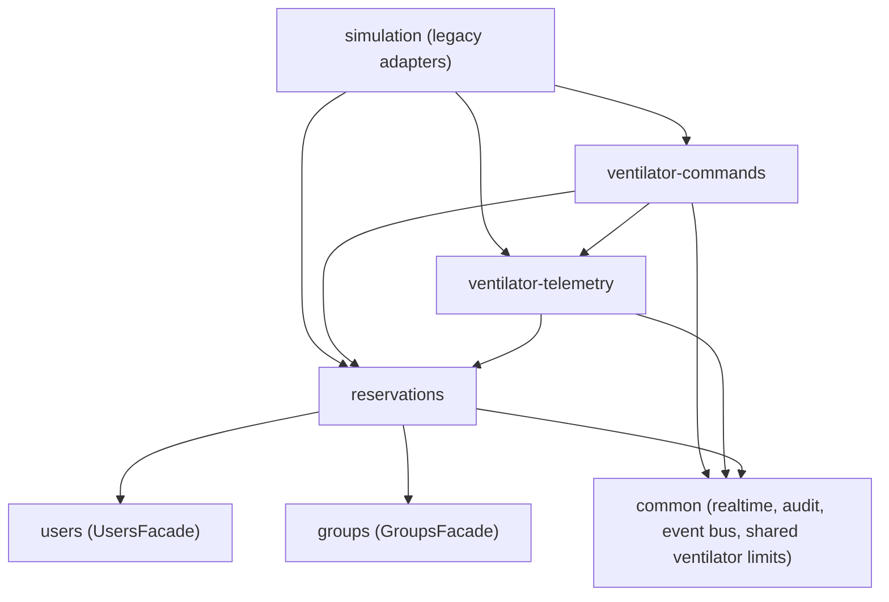

<!--
 * Funcionalidad: Índice de las features del ventilador físico
 * Descripción: Features de reservas, telemetría y comandos del ventilador físico y catálogos de eventos Socket.io y rutas HTTP. v1.1: retira ventilator:reserved, ventilator:released y el ventilator:data de la telemetría, que ya no se emiten
 * Versión: 1.1
 * Autor: Marcela Mazo Castro
 * Proyecto: VentyLab
 * Tesis: Desarrollo de una aplicación web para la enseñanza de mecánica ventilatoria que integre un sistema de retroalimentación usando modelos de lenguaje
 * Institución: Universidad del Valle
 * Contacto: marcela.mazo@correounivalle.edu.co
-->

# Physical ventilator features

Three NestJS features own everything related to the physical ventilator. They replace the real-device code that lived in `src/features/simulation`, which now only keeps thin legacy adapters.

| Feature | Folder | Owns |
| --- | --- | --- |
| Reservations | `src/features/reservations` | Scheduled reservations of the single ventilator, roles, limits, cancellation, teacher and administrator preemption, role-based views. |
| Ventilator telemetry | `src/features/ventilator-telemetry` | The only MQTT connection, decoding, batched low-latency relay to Socket.io, room access, device staleness, metrics, recording. See [telemetry.md](telemetry.md) and [telemetry-bench.md](telemetry-bench.md). |
| Ventilator commands | `src/features/ventilator-commands` | Exclusive operator control, command validation, rate limiting, encoding, publishing, lifecycle and history. See [commands.md](commands.md). |

Related documents: [AUDIT.md](AUDIT.md) (before state and requirement status), [UPPAAL-TRACEABILITY.md](UPPAAL-TRACEABILITY.md), [MIGRATION.md](MIGRATION.md), [OPEN-QUESTIONS.md](OPEN-QUESTIONS.md), [VERIFICATION.md](VERIFICATION.md).

## Dependency graph

Each feature depends only on the facades of the features below it. None of them imports from `simulation`, and `madge --circular` reports no cycle.

## Module APIs

Each module exports exactly one facade.

### `ReservationsFacade` (`ReservationsModule`)

| Method | Purpose |
| --- | --- |
| `getActiveReservation(now)` | The reservation with status `SCHEDULED` and `startsAt <= now < endsAt`, as an `ActiveReservationSummary`, or `undefined`. |
| `isHolder(userId, reservation)` | The user is the holder or a member of the holder group. |
| `listHolderUserIds(reservation)` | Every user who may receive the telemetry of the reservation. |
| `getReservationById(id)` | Summary of any reservation. |
| `isGroupLeaderOfHolder(userId, reservation)` | The user leads the holder group (always `false` for user reservations). |
| `getUsageStats(range, groupId?)` | Counts by status and holder type, and reserved minutes inside the range. |
| `reserveNow(input)` | Legacy "reserve now for N minutes" under the same lock and overlap rules. Returns `reserved` (with `recovered` when the caller already holds it) or `occupied`. |
| `releaseActive(userId, role)` | Completes the active reservation now when the caller may release it. |

### `VentilatorTelemetryFacade` (`VentilatorTelemetryModule`)

| Member | Purpose |
| --- | --- |
| `mqttConnection` | The single `IMqttConnection` (publish with QoS, subscribe, connection state). Only `ventilator-commands` uses it. |
| `getStatus()` | Connection, device and metrics status. |
| `isDeviceOnline()` | Broker connected and device not stale. |
| `getLatestSettings()` | Latest `settings` reported by a frame. |
| `getActiveAlarms()` | Latest alarm per type. |
| `getConnectionInfo()` | Broker URL without credentials and topics. |
| `onFrame(listener)` | Synchronous frame listener; returns the unsubscribe function. |

### `VentilatorCommandsFacade` (`VentilatorCommandsModule`)

| Method | Purpose |
| --- | --- |
| `send(input)` | Runs every check of `POST /api/ventilator/commands` and publishes. Used by the legacy `POST /api/simulation/command`. |
| `getControlOverview()` | Current operator state. |

## Socket.io event catalogue

| Event | Direction | Audience | Payload | Status |
| --- | --- | --- | --- | --- |
| `ventilator:alarm` | server → client | broadcast | `VentilatorAlarm` | legacy |
| `ventilator:telemetry` | server → client | rooms `ventilator`, `role:TEACHER`, `role:ADMIN`, volatile | `{ frames: TelemetryFrame[], serverTs }` | new |
| `ventilator:availability` | server → client | broadcast on reservation change; the user on authentication and on `ventilator:join` | `{ occupied, startsAt?, endsAt? }` | new |
| `ventilator:join-rejected` | server → client | the requesting user | `{ reason: "no_active_reservation" \| "not_reservation_holder" }` | new |
| `ventilator:connected` | server → client | broadcast | `{ at }` | new |
| `ventilator:disconnected` | server → client | broadcast | `{ at, reason: "device_stale" \| "broker_disconnected" }` | new |
| `ventilator:control-changed` | server → client | rooms `ventilator`, `role:TEACHER`, `role:ADMIN` | `{ reservationId, operatorUserId \| null, reason }` | new |
| `ventilator:command-status` | server → client | rooms `ventilator`, `role:TEACHER`, `role:ADMIN` | `{ commandId, reservationId, userId, status, sentAt?, resolvedAt?, latencyMs?, reason? }` | new |
| `reservation:preempted` | server → client | holder group room and every holder user | `{ reservationId, holderType, groupId, startsAt, endsAt, reason, wasActive }` | new |
| `ventilator:join` | client → server | — | none | new |
| `ventilator:heartbeat` | client → server | — | none | new |

The telemetry no longer emits the legacy `ventilator:data` reading, and the legacy reserve and release routes no longer broadcast `ventilator:reserved` / `ventilator:released` (they sent `userId` and `userName` to unauthenticated sockets and had no listener in `ventilab-web`). The frontend consumes `ventilator:telemetry` and the other events above.

## HTTP endpoint catalogue

All routes need a JWT. Responses use the standard `APIResponse` envelope.

| Method and path | Permission | Purpose |
| --- | --- | --- |
| `GET /api/reservations?from&to` | `reservations:read` | Calendar of reservations overlapping `[from, to)` (at most 31 days), projected per role. |
| `GET /api/reservations/mine` | `reservations:read` | Current and upcoming reservations the caller holds, created, or that belong to the caller's student group. |
| `GET /api/reservations/current` | `reservations:read` | Reservation active now and `canControl`. |
| `POST /api/reservations` | `reservations:create` | Create a scheduled reservation (`confirmPreempt` and `preemptReason` for teachers and administrators). |
| `POST /api/reservations/:id/cancel` | `reservations:create` | Cancel a scheduled reservation. |
| `POST /api/reservations/:id/preempt` | `reservations:manage` | Preempt a reservation and create the replacement. |
| `GET /api/ventilator/telemetry/metrics` | `ventilator:metrics` | Counters and latency percentiles. |
| `GET /api/ventilator/telemetry/metrics.csv` | `ventilator:metrics` | One row per retained latency sample. |
| `POST /api/ventilator/telemetry/metrics/reset` | `ventilator:metrics_reset` | Reset the metrics window. |
| `POST /api/ventilator/telemetry/recordings/start` and `.../stop` | `simulation:read` + holder, teacher or administrator | Start or stop recording the active reservation. |
| `GET /api/ventilator/telemetry/recordings/:reservationId` | `simulation:read` + holder, teacher or administrator | Recorded frames ordered by time. |
| `GET /api/ventilator/control` | `ventilator:control` | Operator state for the caller. |
| `POST /api/ventilator/control` | `ventilator:control` | Take the free control. |
| `POST /api/ventilator/control/takeover` | `ventilator:control` | Take the control from the current operator. |
| `DELETE /api/ventilator/control` | `ventilator:control` | Release the control. |
| `POST /api/ventilator/control/heartbeat` | `ventilator:control` | Operator presence. |
| `POST /api/ventilator/commands` | `ventilator:control` | Send a command (`202 Accepted`). |
| `GET /api/ventilator/commands?reservationId&page&limit&sortOrder` | `ventilator:control` | Command history of a reservation. |
| `POST /api/simulation/reserve`, `DELETE /api/simulation/reserve` | `simulation:control` | Legacy adapters over `ReservationsFacade.reserveNow` and `releaseActive`. |
| `POST /api/simulation/command` | `simulation:control` | Legacy adapter; the physical path calls `VentilatorCommandsFacade.send`. |

`ventilator:metrics` (read-only metrics) belongs to teachers and administrators; `ventilator:metrics_reset` belongs to administrators only. `reservations:manage` belongs to teachers and administrators. The other permissions above are held by every role; the real authorization is the reservation and operator logic.

## Environment variables

All defaults come from `src/common/infrastructure/config/env.validation.ts`.

| Variable | Default | Feature | Notes |
| --- | --- | --- | --- |
| `RESERVATION_MAX_DURATION_MINUTES` | 120 | reservations | Maximum length of one reservation. |
| `RESERVATION_SLOT_MINUTES` | 15 | reservations | Slot granularity (1–60). |
| `RESERVATION_MAX_ADVANCE_DAYS` | 14 | reservations | How far ahead a reservation may start. |
| `RESERVATION_MAX_FUTURE_PER_STUDENT` | 3 | reservations | Upcoming scheduled reservations per student. |
| `RESERVATION_MAX_FUTURE_PER_GROUP` | 5 | reservations | Upcoming scheduled reservations per group. |
| `VENTILATOR_DEVICE_ID` | `ventilab-device-001` | reservations, telemetry | Device id and advisory lock key. |
| `MQTT_BROKER_URL` (alias `MQTT_URL`) | unset | telemetry | The MQTT connection exists only when set. No public default broker. |
| `MQTT_CLIENT_ID` | `ventylab-server-<pid>-<random>` | telemetry | |
| `MQTT_USERNAME`, `MQTT_PASSWORD` | unset | telemetry | |
| `MQTT_TELEMETRY_TOPIC` | `/ventynet/data` | telemetry | QoS 0. |
| `MQTT_ALARM_TOPIC` | `ventilab/device/001/alarm` | telemetry | QoS 1. |
| `MQTT_RECONNECT_BASE_MS` / `MQTT_RECONNECT_MAX_MS` | 1000 / 30000 | telemetry | Infinite exponential backoff with jitter. |
| `VENTILATOR_TELEMETRY_DECODER` | `auto` | telemetry | `auto`, `json` or `hex`. |
| `VENTILATOR_FLUSH_INTERVAL_MS` | 33 | telemetry | Batch period (5–1000). |
| `VENTILATOR_MAX_BUFFERED_FRAMES` | 256 | telemetry | Batch buffer cap (1–100000); the oldest frames are dropped and counted in `bufferDrops`. |
| `VENTILATOR_STALE_AFTER_MS` | 2000 | telemetry | |
| `VENTILATOR_ROOM_REFRESH_MS` | 1000 | telemetry | |
| `VENTILATOR_METRICS_WINDOW` | 10000 | telemetry | |
| `VENTILATOR_SEQ_REORDER_WINDOW` | 16 | telemetry | 0–1024. Late frames within this distance of the newest `seq` count as reordered; a wraparound is accepted only when the implied loss is at most 64 times this window. |
| `VENTILATOR_SEQ_WRAP_BITS` | 0 | telemetry | `0`, `16` or `32`. Width of the device sequence counter; 0 disables wraparound. |
| `VENTILATOR_INVALID_LOG_INTERVAL_MS` | 5000 | telemetry | |
| `VENTILATOR_RECORDING_HZ` | 20 | telemetry | |
| `VENTILATOR_RECORDING_FLUSH_SECONDS` | 5 | telemetry | |
| `INFLUXDB_URL`, `INFLUXDB_TOKEN`, `INFLUXDB_ORG`, `INFLUXDB_BUCKET` | unset | telemetry | Optional sink, enabled when all four are set. |
| `MQTT_COMMAND_TOPIC` | `ventilab/device/001/command` | commands | QoS 1. |
| `MQTT_COMMAND_ACK_TOPIC` | empty | commands | Empty disables ACK tracking. |
| `MQTT_TEST_TOPIC_PREFIX` | `test/ventylab` | commands | Prefix applied when `NODE_ENV=test`. |
| `VENTILATOR_COMMAND_ENCODING` | `json` | commands | `json` or `hex`. |
| `VENTILATOR_COMMAND_TIMEOUT_MS` | 3000 | commands | |
| `VENTILATOR_COMMAND_RATE_PER_SECOND` | 5 | commands | |
| `VENTILATOR_OPERATOR_GRACE_SECONDS` | 15 | commands | |
| `VENTILATOR_CONTROL_REFRESH_MS` | 1000 | commands | |
| `VENTILATOR_APPLY_TOLERANCE_RATIO` | 0.05 | commands | |
| `VENTILATOR_SAFETY_MAX_PEEP` | 15 | commands | |
| `VENTILATOR_SAFETY_MAX_PRESSURE_LIMIT` | 40 | commands | |
| `VENTILATOR_SAFETY_MAX_TIDAL_VOLUME` | 700 | commands | |
| `VENTILATOR_SAFETY_MAX_RESPIRATORY_RATE` | 35 | commands | |
| `VENTILATOR_SAFETY_MAX_IE_RATIO` | 1 | commands | |

### `.env.example` (not updated)

`.env.example` could not be updated in this work: reading it was denied by the environment's permission rules. Apply these changes by hand:

- Remove `WS_MAX_HZ` (no longer read; the telemetry rate is set by `VENTILATOR_FLUSH_INTERVAL_MS`).
- Remove any `MQTT_BROKER_URL=mqtt://test.mosquitto.org:1883` default or comment. Leave `MQTT_BROKER_URL` empty unless the server must connect to the device broker.
- Add, with the defaults above, every variable of the table that is not already present. `MQTT_BROKER_URL`, `MQTT_URL`, `MQTT_CLIENT_ID`, `MQTT_USERNAME`, `MQTT_PASSWORD`, `MQTT_TELEMETRY_TOPIC`, `MQTT_COMMAND_TOPIC` and `MQTT_ALARM_TOPIC` were already validated before this work and may already be listed; all the `RESERVATION_*`, `VENTILATOR_*`, `MQTT_RECONNECT_*`, `MQTT_COMMAND_ACK_TOPIC`, `MQTT_TEST_TOPIC_PREFIX` and `INFLUXDB_*` variables are new to the validated configuration.
